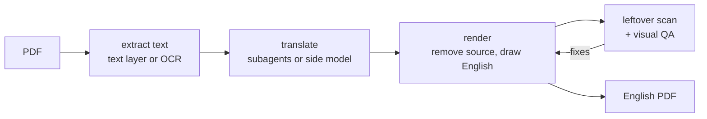

# Knitting Pattern Translate

An [Agent Skill](https://agentskills.io) that translates Japanese and Korean knitting and crochet pattern PDFs into English **in place**: same PDF, same photos, charts and diagrams, English where the original text was.

It handles PDFs with real text (common for Korean designer patterns) and books whose text is drawn as shapes or scanned (common for Japanese books, read with on-device OCR). Labels, legends, row counts and markers keep their position, size and colour, and standard US knitting terms are used (k2tog, ssk, M1L, …).

## Requirements

- A Mac or Linux computer (on Windows, use WSL).
- Python 3.
- An AI coding agent that can run commands and look at images, such as Claude Code, Codex, Gemini CLI, Cursor, Copilot or pi.
- About 1 GB of free disk space for the text-recognition tools and working files.

## Install

Clone the repo into your agent's skills folder, named `knitting-pattern-translate`:

```bash
git clone https://github.com/Joseph-DiGiovanni/knitting-pattern-translate-skill <skills-folder>/knitting-pattern-translate
```

| Agent | Skills folder |
|---|---|
| [Claude Code](https://code.claude.com/docs/en/skills) | `~/.claude/skills/` |
| [Codex](https://developers.openai.com/codex/skills), [Gemini CLI](https://geminicli.com/docs/cli/skills), [Cursor](https://cursor.com/docs/skills), [Copilot](https://docs.github.com/en/copilot/how-tos/copilot-cli/customize-copilot/add-skills) | `~/.agents/skills/` |
| [OpenCode](https://opencode.ai/docs/skills) | `~/.config/opencode/skills/` |
| [pi](https://pi.dev/docs/latest/skills) | `~/.pi/agent/skills/` |
| [oh-my-pi](https://github.com/can1357/oh-my-pi) | `~/.omp/agent/skills/` |

These are the all-projects folders; see each agent's docs for per-project folders. Start a new session (or `/reload` in pi) after installing.

Or, if you have Node.js, use the cross-agent [`skills`](https://github.com/vercel-labs/skills) installer, which detects your agents (add `-a claude-code`, `-a pi`, etc. to choose):

```bash
npx skills add Joseph-DiGiovanni/knitting-pattern-translate-skill -g
```

## Usage

> Translate `pattern.pdf` to English.

The agent extracts the text, translates it, renders `<name>_English.pdf`, checks for leftover source text, reviews the pages and applies fixes. Ask for wording changes afterwards and it re-renders only those pages.

Translation and page review run in subagents to keep the main conversation small. Agents without subagents (such as pi by default) do this work in their own context, which costs more tokens.

## How it works



The agent drives `scripts/kpt`, a Python command-line tool (PyMuPDF, OpenCV, RapidOCR); `kpt --help` lists its commands. On first run, `scripts/kpt` creates a private Python 3.12 environment in `scripts/.venv` using `uv` (installed with `pip` if missing), about 500 MB, and RapidOCR downloads its models the first time a scanned page is processed. No system packages are installed. All state lives in a work folder, so every step can be resumed or re-run for single pages.

1. **Extract.** Pages with a text layer are read exactly, with font size, colour, weight, slant, underline and angle, including words styled differently from the rest of their line. Other pages are rendered and read with multi-pass RapidOCR (full page at several resolutions, overlapping tiles for small labels in dense diagrams, and re-reads of low-confidence lines).
2. **Translate.** `kpt prompts` writes one compact prompt per page (text boxes with ids and positions, differently styled words tagged) plus shared rules and a glossary from `prompts/`. Subagents or a side model return JSON that groups boxes into units and translates them, carrying the style tags over to the matching English words; `kpt validate` checks every box is covered once, and `kpt unify` makes labels that repeat across pages, such as legends, consistent.
3. **Render.** Text-layer glyphs are removed by redaction, leaving backgrounds and artwork untouched. OCR'd text is covered with a flat fill or inpainted on photos and gradients. English is drawn in the source style and alignment, with bold, coloured, underlined or smaller words kept as in the original, and labels stacked in a column keep their shared edge. Paragraphs are re-flowed as one block at one size, using blank lines below and tighter spacing before shrinking; inline graphics (small shapes or glyphs within running text) move with their word, and leader lines from underlined words or inline graphics to a note follow them. Labels grow or wrap into free space before being shrunk, and tilted labels are redrawn along their original baseline.
4. **Check.** `kpt resid` lists source text still present, from the text layer and by OCR of the rendered pixels. Visual QA subagents compare each translated page with the original as a whole and in zooms, and report findings in a fixed format that names the zoom images: wrong text or style, misalignment, overlap, uneven paragraph sizing, missed text, damaged artwork. `kpt apply` turns those into per-page fixes, and only the affected pages are re-rendered.

`SKILL.md` holds the full workflow and token-saving rules; `prompts/` holds the translation rules, glossaries and subagent briefs.

To add a language, add an entry to `LANGS` in `scripts/kpt.py` and a `prompts/glossary-knitting-<lang>.md`. For another craft, add `prompts/glossary-<craft>-<lang>.md` and pass `-g <craft>` to `kpt prompts`.

## Limitations

- It's a machine translation: check stitch counts, row counts and measurements against the original charts before knitting.
- English is longer than Japanese or Korean, so labels in crowded diagrams can come out small.
- Leader lines and arrows are only moved when they hang off a re-flowed paragraph; longer pointers across a diagram stay where they were.

## Copyright

Pattern PDFs are usually copyrighted. Translate patterns you own for your own use, and don't share translated copies without the designer's permission.
